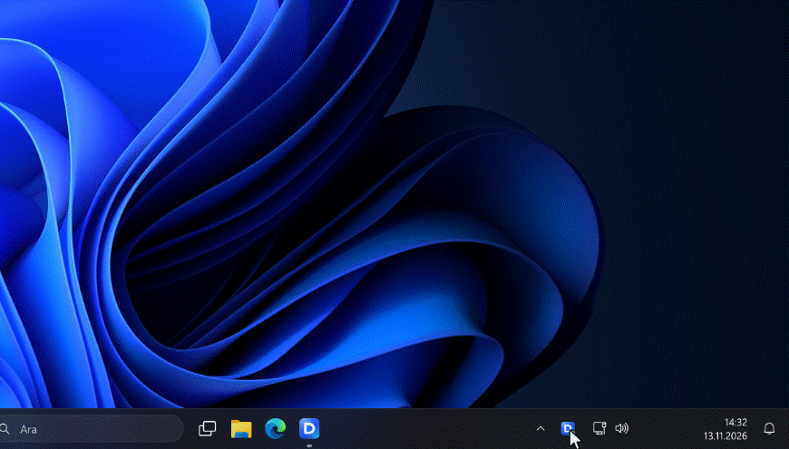
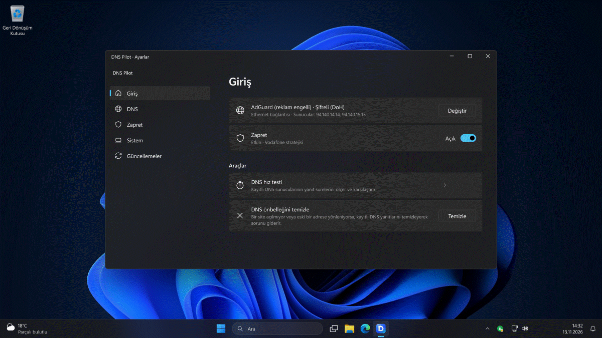
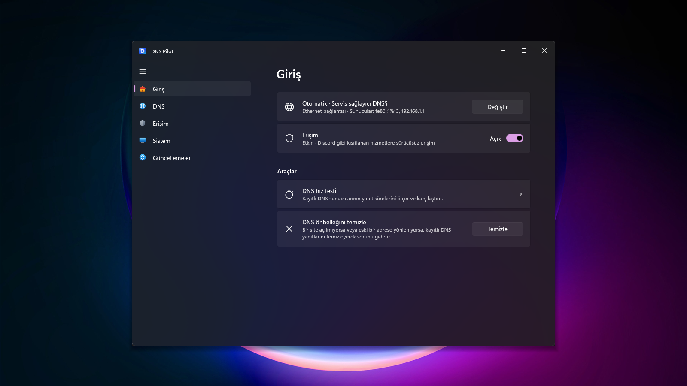
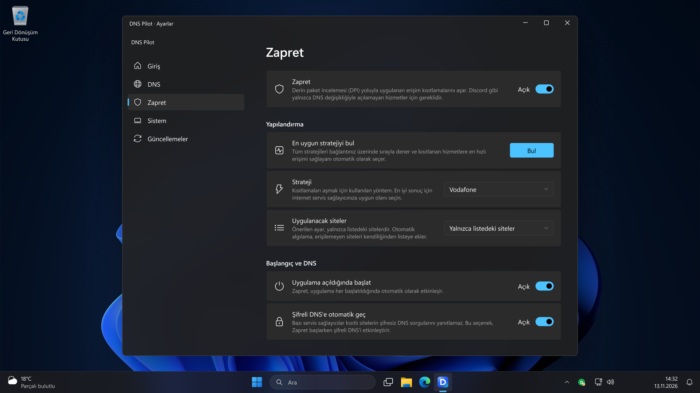
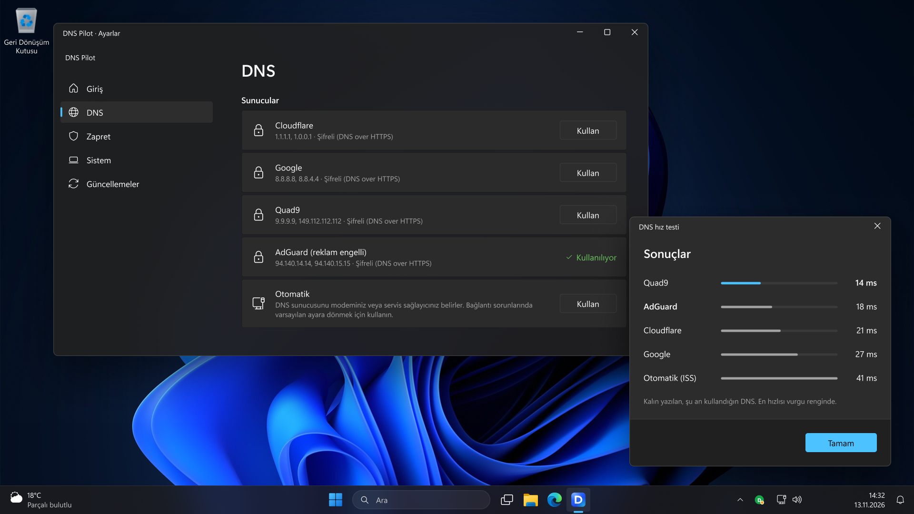
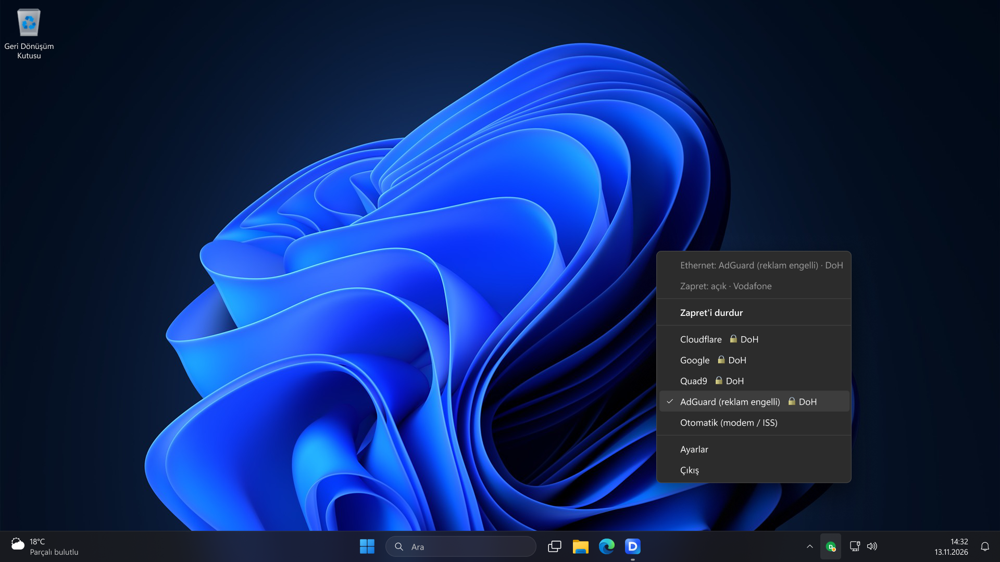

<p align="center">
  
</p>

<p align="center">
  
  
  
  
  
</p>

<p align="center">
  <b>Tek tıkla şifreli DNS'e geçin, DPI kaynaklı erişim kısıtlamalarını aşın.</b><br>
  Bildirim alanında sessizce çalışan, Windows 11 tasarımında hafif bir ağ aracı.
</p>

<p align="center">
  <a href="#-öne-çıkanlar">Öne çıkanlar</a> ·
  <a href="#-ekran-görüntüleri">Ekran görüntüleri</a> ·
  <a href="#-kurulum">Kurulum</a> ·
  <a href="#-nasıl-kullanılır">Kullanım</a> ·
  <a href="#-geliştirme">Geliştirme</a>
</p>

---

<p align="center">
  
  <br><sub>Tepsi menüsünden AdGuard'a geçiş: simgedeki nokta yeşile döner, Windows bildirimi onaylar.</sub>
</p>

## ✨ Öne çıkanlar

| | |
|---|---|
| 🔒 **Şifreli DNS** | Cloudflare, Google, Quad9 ve AdGuard hazır gelir. DNS over HTTPS (DoH) ile sorgularınız servis sağlayıcınızdan gizlenir. Geçmeden önce bağlantı test edilir; ulaşılamayan sunucuya geçilmez. |
| 🛡️ **Zapret ile erişim** | Discord gibi yalnızca DNS değiştirerek açılmayan hizmetler için, derin paket incelemesine (DPI) karşı açık kaynaklı Zapret motorunu tek tıkla başlatır. |
| 🎯 **En uygun strateji** | Tüm stratejileri kendi bağlantınızda sırayla dener, kısıtlanan hizmetlere en hızlı erişimi sağlayanı otomatik seçer. |
| 🟢 **Anlık durum** | Bildirim alanındaki simgenin noktası bağlantınızın durumunu gösterir: şifreli, şifresiz, ISS ya da bağlantı yok. |
| ⚡ **Araçlar** | DNS hız testi, tek tıkla DNS önbelleğini temizleme, kendi DNS profillerinizi ekleme. |
| 🪟 **Windows 11 tasarımı** | Ayarlar penceresi Windows 11 Ayarlar uygulamasının düzenini izler; açık ve koyu temaya kendiliğinden uyar. |
| 🚀 **Windows ile başlat** | Oturum açıldığında yönetici onayı sormadan bildirim alanında başlar; Zapret'i de otomatik açabilir. |
| 🙈 **Gizlilik** | Hesap, reklam, analiz ya da telemetri yok. Ayarlar yalnızca bilgisayarınızda saklanır. |

## 🖼️ Ekran görüntüleri

<p align="center">
  
</p>

<table>
  <tr>
    <td width="50%"><p align="center"><sub><b>Giriş</b> — DNS ve Zapret durumu, hızlı araçlar</sub></p></td>
    <td width="50%"><p align="center"><sub><b>Zapret</b> — strateji, site listesi, otomatik başlatma</sub></p></td>
  </tr>
  <tr>
    <td width="50%"><p align="center"><sub><b>DNS</b> — sunucu seçimi ve hız testi</sub></p></td>
    <td width="50%"><p align="center"><sub><b>Tepsi menüsü</b> — en sık kullanılanlar tek tıkta</sub></p></td>
  </tr>
</table>

## 📦 Kurulum

### Microsoft Store
DNS Pilot, Microsoft Store incelemesindedir. Yayımlandığında [Store sayfasından](https://apps.microsoft.com/detail/9PL0M0W0MP7L) tek tıkla kurulabilecek ve güncellemeleri otomatik alacaktır.

### Kaynaktan derleme
Ek bir kurulum gerekmez; Windows'un yerleşik .NET Framework 4.8 derleyicisi kullanılır.

```powershell
powershell -ExecutionPolicy Bypass -File build.ps1
```

Çıktı: `bin\DnsDegistirici.exe`. DNS ayarlarını değiştirebilmek için uygulama yönetici izniyle açılır. Zapret motoru ilk kullanımda **Ayarlar → Güncellemeler** sayfasından indirilir.

## 🧭 Nasıl kullanılır

1. **DNS Pilot**'u açın; bildirim alanında logo simgesi belirir.
2. **Sağ tık:** DNS sunucusu seçin, Zapret'i başlatın ya da durdurun.
3. **Sol tık:** Ayarlar penceresi açılır — Giriş, DNS, Zapret, Sistem ve Güncellemeler sayfaları.

**Simgedeki nokta ne anlatır?**

| Nokta | Anlamı |
|:---:|---|
| 🟢 | Şifreli DNS (DoH) etkin |
| 🟣 | Özel DNS, şifresiz |
| ⚪ | Modemin / servis sağlayıcının DNS'i |
| 🟠 | Zapret çalışıyor |
| 🔴 | Bağlantı yok |

### DNS ile Zapret arasındaki fark
- **DNS** — Servis sağlayıcının DNS yönlendirmesini aşar ve DNS trafiğini şifreler.
- **Zapret** — DPI ile uygulanan kısıtlamaları aşar. Bazı hizmetler için yalnızca DNS değiştirmek yetmez; Zapret başlarken DNS şifresizse uygulama otomatik olarak şifreli bir sunucuya geçer.

> [!TIP]
> Hangi stratejinin size uygun olduğunu bilmiyorsanız **Ayarlar → Zapret → En uygun stratejiyi bul**'u kullanın. Yaklaşık bir dakika içinde bağlantınızda en iyi çalışanı seçer.

### Sorun olursa
- İnternet kesilirse menüden **Otomatik (modem / ISS)** seçin.
- Bir site bozulursa **Zapret'i durdurun** ya da başka bir strateji deneyin.
- Uygulamadan çıkıldığında Zapret de kapanır.

## 🛠️ Geliştirme

| Komut | Çıktı |
|---|---|
| `powershell -ExecutionPolicy Bypass -File build.ps1` | `bin\DnsDegistirici.exe` |
| `powershell -ExecutionPolicy Bypass -File installer\build-setup.ps1` | `dist\DNSPilot-Setup-<sürüm>.exe` (sessiz kurulum `/S`, kaldırma `/uninstall /S`) |
| `powershell -ExecutionPolicy Bypass -File msix\build-msix.ps1 -Tools <SDK x64> -Engine bin\zapret\motor` | `dist\DNSPilot.msix` (Microsoft Store paketi) |

<details>
<summary><b>Proje yapısı</b></summary>

```
src/            Uygulama (C#, WinForms, .NET Framework 4.8)
  Tray.cs         Bildirim alanı, menü, güncellemeler, otomatik başlatma
  SettingsForm.cs Windows 11 tarzı Ayarlar penceresi
  Dns.cs          DNS ve DoH ayarları, hız testi
  Zapret.cs       Zapret motoru ve ayar dosyaları
  StrategyTest.cs En uygun stratejiyi ölçme
  icon/           Logo kaynakları ve app.ico üretimi
installer/      Klasik kurulum (setup.exe)
msix/           Microsoft Store paketi (AppxManifest, paketleme betiği)
store/          Store görselleri
docs/img/       README görselleri
```
</details>

<details>
<summary><b>Veri klasörleri</b></summary>

| Dosya | Açıklama |
|---|---|
| `profiles.txt` | DNS profilleri |
| `ayarlar.txt` | Seçili strateji ve diğer ayarlar |
| `zapret\hostlist.txt`, `excludelist.txt`, `stratejiler.txt` | Zapret site listeleri ve stratejiler |
| `zapret\motor\` | Zapret motoru (klasik kurulumda güncellemeyle yenilenir) |

Klasik kurulumda bu dosyalar exe'nin yanında, Microsoft Store sürümünde uygulamanın kendi veri klasöründe (`%LOCALAPPDATA%\Packages\Aegyip.DNSPilot_…\LocalCache\Local\DNS Pilot`) durur.
</details>

## 🔐 Gizlilik

DNS Pilot hiçbir kişisel veri toplamaz ve geliştiriciye veri göndermez. Seçtiğiniz DNS sağlayıcısı, alan adı sorgularınızı ve IP adresinizi görür; onun gizlilik politikası geçerlidir. Hız ve strateji testlerinin sonuçları cihazınızdan çıkmaz.

## 🙏 Teşekkürler

- [**Zapret**](https://github.com/bol-van/zapret) — bol-van; DPI aşma motoru
- [**WinDivert**](https://github.com/basil00/WinDivert) — basil00; Windows paket yakalama sürücüsü

## ⚠️ Sorumluluk

DNS Pilot, kullanıcının kendi bilgisayarındaki ağ ayarlarını değiştirir. Uygulamayı yürürlükteki yasalara ve internet servis sağlayıcınızın koşullarına uygun şekilde kullanmak kullanıcının sorumluluğundadır.

<p align="center"><sub>© 2026 Aegyip · DNS Pilot</sub></p>
