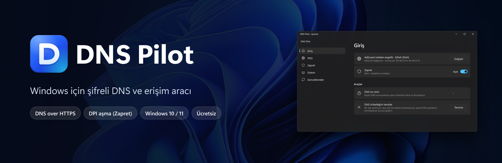
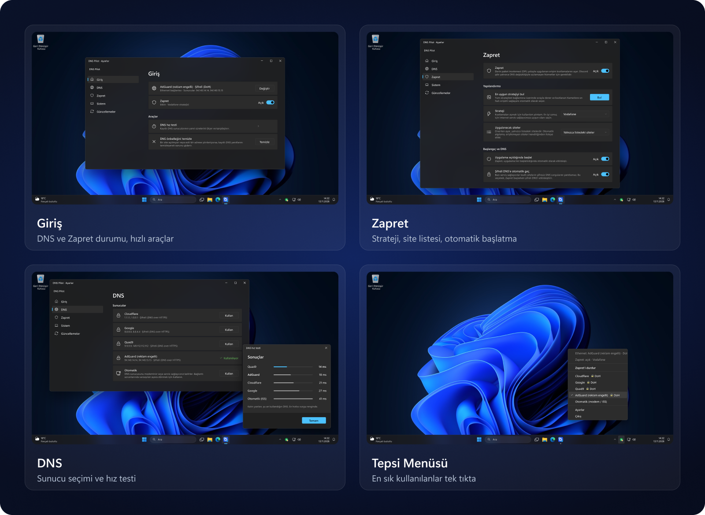
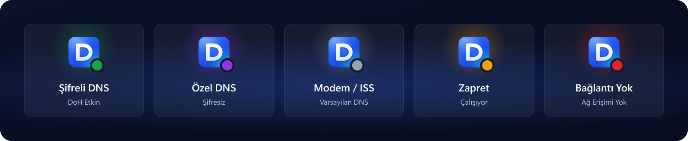
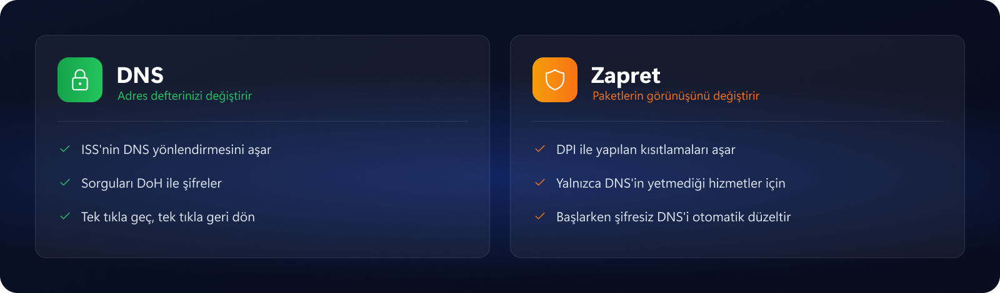
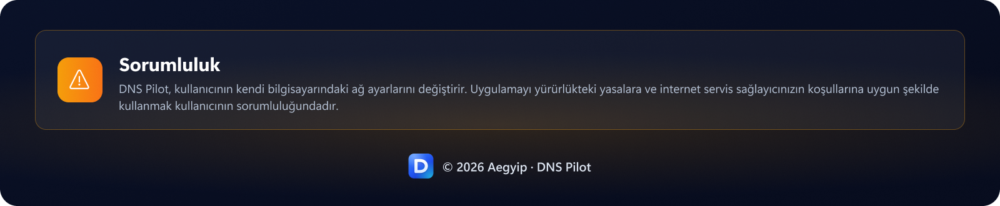

<p align="center">
  
</p>

<p align="center">
  
  
  
  
  
</p>

<p align="center">
  <b>Tek tıkla şifreli DNS'e geçin, DPI kaynaklı erişim kısıtlamalarını aşın.</b><br>
  Bildirim alanında sessizce çalışan, Windows 11 tasarımında hafif bir ağ aracı.
</p>

<p align="center">
  <a href="#-öne-çıkanlar">Öne çıkanlar</a> ·
  <a href="#-ekran-görüntüleri">Ekran görüntüleri</a> ·
  <a href="#-kurulum">Kurulum</a> ·
  <a href="#-nasıl-kullanılır">Kullanım</a> ·
  <a href="https://github.com/Aegyip/dns-pilot/issues/new?template=hata-bildirimi.yml">Hata bildir</a>
</p>

---

<p align="center">
  
  <br><sub>Tepsi menüsünden AdGuard'a geçiş: simgedeki nokta yeşile döner, Windows bildirimi onaylar.</sub>
</p>

## ✨ Öne çıkanlar

<p align="center">
  
</p>

## 🖼️ Ekran görüntüleri

<p align="center">
  
</p>

<p align="center">
  
</p>

## 📦 Kurulum

<p align="center">
  
</p>

<p align="center">
  <a href="https://apps.microsoft.com/detail/9PL0M0W0MP7L"></a>
  <br><sub>Store incelemesi sürüyor; yayımlandığında bu bağlantı etkinleşir. Güncellemeler Store üzerinden otomatik gelir.</sub>
</p>

<details>
<summary><b>Kaynaktan derleme</b></summary>

Ek bir kurulum gerekmez; Windows'un yerleşik .NET Framework 4.8 derleyicisi kullanılır.

```powershell
powershell -ExecutionPolicy Bypass -File build.ps1
```

Çıktı: `bin\DnsDegistirici.exe`. DNS ayarlarını değiştirebilmek için uygulama yönetici izniyle açılır. Zapret motoru ilk kullanımda **Ayarlar → Güncellemeler** sayfasından indirilir.
</details>

## 🧭 Nasıl kullanılır

### Simgedeki nokta ne anlatır?

<p align="center">
  
</p>

### DNS mi, Zapret mi?

<p align="center">
  
</p>

> [!TIP]
> Hangi stratejinin size uygun olduğunu bilmiyorsanız **Ayarlar → Zapret → En uygun stratejiyi bul**'u kullanın. Yaklaşık bir dakika içinde bağlantınızda en iyi çalışanı seçer.

### Sorun olursa
- İnternet kesilirse menüden **Otomatik (modem / ISS)** seçin.
- Bir site bozulursa **Zapret'i durdurun** ya da başka bir strateji deneyin.
- Uygulamadan çıkıldığında Zapret de kapanır.

<details>
<summary><b>🛠️ Geliştirme</b></summary>

| Komut | Çıktı |
|---|---|
| `powershell -ExecutionPolicy Bypass -File build.ps1` | `bin\DnsDegistirici.exe` |
| `powershell -ExecutionPolicy Bypass -File installer\build-setup.ps1` | `dist\DNSPilot-Setup-<sürüm>.exe` (sessiz kurulum `/S`, kaldırma `/uninstall /S`) |
| `powershell -ExecutionPolicy Bypass -File msix\build-msix.ps1 -Tools <SDK x64> -Engine bin\zapret\motor` | `dist\DNSPilot.msix` (Microsoft Store paketi) |
</details>

<details>
<summary><b>Proje yapısı</b></summary>

```
src/            Uygulama (C#, WinForms, .NET Framework 4.8)
  Tray.cs         Bildirim alanı, menü, güncellemeler, otomatik başlatma
  SettingsForm.cs Windows 11 tarzı Ayarlar penceresi
  Dns.cs          DNS ve DoH ayarları, hız testi
  Zapret.cs       Zapret motoru ve ayar dosyaları
  StrategyTest.cs En uygun stratejiyi ölçme
  icon/           Logo kaynakları ve app.ico üretimi
installer/      Klasik kurulum (setup.exe)
msix/           Microsoft Store paketi (AppxManifest, paketleme betiği)
store/          Store görselleri
docs/img/       README görselleri
```
</details>

<details>
<summary><b>Veri klasörleri</b></summary>

| Dosya | Açıklama |
|---|---|
| `profiles.txt` | DNS profilleri |
| `ayarlar.txt` | Seçili strateji ve diğer ayarlar |
| `zapret\hostlist.txt`, `excludelist.txt`, `stratejiler.txt` | Zapret site listeleri ve stratejiler |
| `zapret\motor\` | Zapret motoru (klasik kurulumda güncellemeyle yenilenir) |

Klasik kurulumda bu dosyalar exe'nin yanında, Microsoft Store sürümünde uygulamanın kendi veri klasöründe (`%LOCALAPPDATA%\Packages\Aegyip.DNSPilot_…\LocalCache\Local\DNS Pilot`) durur.
</details>

<p align="center">
  
</p>

<details>
<summary><b>🙏 Teşekkürler</b></summary>

- [**Zapret**](https://github.com/bol-van/zapret) — bol-van; DPI aşma motoru
- [**WinDivert**](https://github.com/basil00/WinDivert) — basil00; Windows paket yakalama sürücüsü
</details>

<p align="center">
  
</p>
