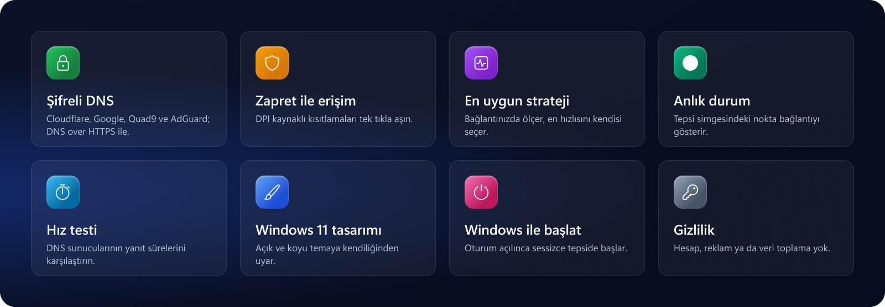
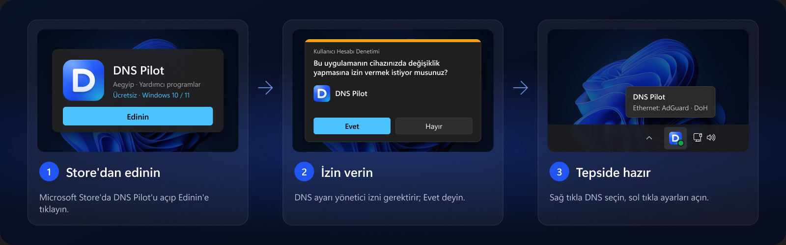

<p align="center">
  
</p>

<p align="center">
  
  
  
  
  
</p>

<p align="center">
  <b>Tek tıkla şifreli DNS'e geçin, DPI kaynaklı erişim kısıtlamalarını aşın.</b><br>
  Bildirim alanında sessizce çalışan, Windows 11 tasarımında hafif bir ağ aracı.
</p>

<p align="center">
  <a href="#-öne-çıkanlar">Öne çıkanlar</a> ·
  <a href="#-ekran-görüntüleri">Ekran görüntüleri</a> ·
  <a href="#-kurulum">Kurulum</a> ·
  <a href="#-nasıl-kullanılır">Kullanım</a> ·
  <a href="https://github.com/Aegyip/dns-pilot/issues/new?template=hata-bildirimi.yml">Hata bildir</a>
</p>

---

<p align="center">
  
  <br><sub>Tepsi menüsünden AdGuard'a geçiş: simgedeki nokta yeşile döner, Windows bildirimi onaylar.</sub>
</p>

## ✨ Öne çıkanlar

<p align="center">
  
</p>

## 🖼️ Ekran görüntüleri

<p align="center">
  
</p>

<p align="center">
  
</p>

## 📦 Kurulum

<p align="center">
  
</p>

<p align="center">
  <a href="https://apps.microsoft.com/detail/9PL0M0W0MP7L"></a>
  <br><sub>Store incelemesi sürüyor; yayımlandığında bu bağlantı etkinleşir. Güncellemeler Store üzerinden otomatik gelir.</sub>
</p>

<details>
<summary><b>Kaynaktan derleme</b></summary>

Uygulama WinUI 3 (Windows App SDK) ile yazılmıştır. Derlemek için **.NET 8 SDK** gerekir (`winget install Microsoft.DotNet.SDK.8`); Visual Studio gerekmez, NuGet paketleri ilk derlemede indirilir.

```powershell
dotnet build WinUI\DnsPilot.WinUI.csproj -c Debug -p:Platform=x64
```

Çıktı: `bin\winui\DnsPilot.exe`. DNS ayarlarını değiştirebilmek için uygulama yönetici izniyle açılır. Zapret motoru ilk kullanımda **Ayarlar → Güncellemeler** sayfasından indirilir.
</details>

## 🧭 Nasıl kullanılır

### Simgedeki nokta ne anlatır?

<p align="center">
  
</p>

### DNS mi, Zapret mi?

<p align="center">
  
</p>

### Sürücüsüz erişim (2.2)

Varsayılan erişim yöntemi artık sürücü kurmaz; Microsoft Store sürümü de bunu kullanır. Zapret yalnızca GitHub kurulumunda, **Erişim → Erişim yöntemi** altından seçilebilir.

- Windows'un ad çözümleme ilkesine (NRPT) geçici bir kural eklenir: yalnızca site listesindeki adlar (discord.com …) uygulamanın yerel DNS'ine (`127.88.0.1`) sorulur, diğer her şey eskisi gibi çözülür. Kural yeniden başlatınca kendiliğinden silinir.
- Bu adlara açılan bağlantılar `127.88.0.1:443`'e gelir; uygulama site adını okuyup gerçek sunucuya doğrudan bağlanır ve yalnızca ilk paketi (TLS ClientHello) iki TLS kaydına bölerek gönderir. Şifre çözülmez, trafik uzak bir sunucudan dolaşmaz, **ping değişmez**. Discord sesi (UDP) bu yola hiç uğramaz.
- Discord masaüstü güncelleyicisi yalnızca TLS 1.2 konuştuğu için bu yolla geçemez; **Discord uyumluluğu** seçeneği Discord'un kendi "güncelleme denetimi başarısızsa yine de aç" ayarını açar (Discord birkaç saniye sonra açılır, istemcinin kendisi discord.com'dan güncel yüklenir).

> [!TIP]
> Zapret kullanıyorsanız ve hangi stratejinin size uygun olduğunu bilmiyorsanız **Ayarlar → Erişim → En uygun stratejiyi bul**'u kullanın. Yaklaşık bir dakika içinde bağlantınızda en iyi çalışanı seçer.

### Sorun olursa
- İnternet kesilirse menüden **Otomatik (modem / ISS)** seçin.
- Bir site bozulursa **erişimi durdurun** ya da başka bir bölme biçimi / strateji deneyin.
- Uygulamadan çıkıldığında erişim de kapanır; ad çözümleme kuralı ve Zapret'in açılırken yaptığı DNS değişikliği geri alınır.
- Sorunu bildirirken **Ayarlar → Sistem → Tanılama bilgilerini kopyala** ile alınan metni bildirime ekleyin. Kayıt dosyası: `%TEMP%\DnsPilot-kayit.txt`.

<details>
<summary><b>🛠️ Geliştirme</b></summary>

| Komut | Çıktı |
|---|---|
| `dotnet build WinUI\DnsPilot.WinUI.csproj -c Debug -p:Platform=x64` | `bin\winui\DnsPilot.exe` (geliştirme; veri dosyaları üstteki `bin\`'de aranır) |
| `powershell -ExecutionPolicy Bypass -File WinUI\publish.ps1` | `dist\winui-publish\` (.NET ve Windows App SDK gömülü dağıtım klasörü) |
| `powershell -ExecutionPolicy Bypass -File installer\build-setup.ps1` | `dist\DNSPilot-Setup-<sürüm>.exe` (sessiz kurulum `/S`, kaldırma `/uninstall /S`) |
| `powershell -ExecutionPolicy Bypass -File msix\build-msix.ps1 -Tools <SDK x64>` | `dist\DNSPilot.msix` (Microsoft Store paketi, Zapret motoru ve sürücü içermez; `-Out` ile ad verilebilir) |

Kurucu ve MSIX, yayın klasörünü (`dist\winui-publish\`) kullanır; yoksa önce `WinUI\publish.ps1` çalıştırılır. `<SDK x64>`: `%USERPROFILE%\.nuget\packages\microsoft.windows.sdk.buildtools\<sürüm>\bin\<sürüm>\x64`.
</details>

<details>
<summary><b>Proje yapısı</b></summary>

```
WinUI/          Uygulama arayüzü (WinUI 3, .NET 8): pencere, sayfalar, tepsi menüsü, bildirimler
  AppController.cs İşler: DNS, erişim (sürücüsüz / Zapret), strateji testi, güncellemeler, otomatik başlatma
  Pages/          Giriş, DNS, Erişim, Sistem, Güncellemeler (Windows Ayarlar kartları)
  TrayMenuHost.cs Windows 11 tarzı tepsi menüsü (akrilik)
src/            Paylaşılan mantık (DNS, erişim, Zapret, ayarlar, tanılama)
  Dns.cs          DNS ve DoH ayarları, hız testi
  Bypass.cs       Sürücüsüz erişim: NRPT kuralı, yerel DNS, ClientHello bölen yerel dinleyici, DoH
  DiscordFix.cs   Discord masaüstü uyumluluk ayarı
  Zapret.cs       Zapret motoru ve ayar dosyaları
  StrategyTest.cs En uygun stratejiyi ölçme
  ProcessRunner.cs Zaman sınırlı dış komutlar (netsh, schtasks, sc)
  Diag.cs         Tanılama kaydı
  icon/           Logo kaynakları ve app.ico üretimi
installer/      Klasik kurulum (setup.exe)
msix/           Microsoft Store paketi (AppxManifest, paketleme betiği)
store/          Store görselleri
docs/img/       README görselleri
```
</details>

<details>
<summary><b>Veri klasörleri</b></summary>

| Dosya | Açıklama |
|---|---|
| `profiles.txt` | DNS profilleri |
| `ayarlar.txt` | Seçili strateji ve diğer ayarlar |
| `zapret\hostlist.txt`, `excludelist.txt`, `stratejiler.txt` | Zapret site listeleri ve stratejiler |
| `zapret\motor\` | Zapret motoru (klasik kurulumda güncellemeyle yenilenir) |

Klasik kurulumda bu dosyalar exe'nin yanında, Microsoft Store sürümünde uygulamanın kendi veri klasöründe (`%LOCALAPPDATA%\Packages\Aegyip.DNSPilot_…\LocalCache\Local\DNS Pilot`) durur.
</details>

<p align="center">
  
</p>

<details>
<summary><b>🙏 Teşekkürler</b></summary>

- [**Zapret**](https://github.com/bol-van/zapret) — bol-van; DPI aşma motoru
- [**WinDivert**](https://github.com/basil00/WinDivert) — basil00; Windows paket yakalama sürücüsü
</details>

<p align="center">
  
</p>
